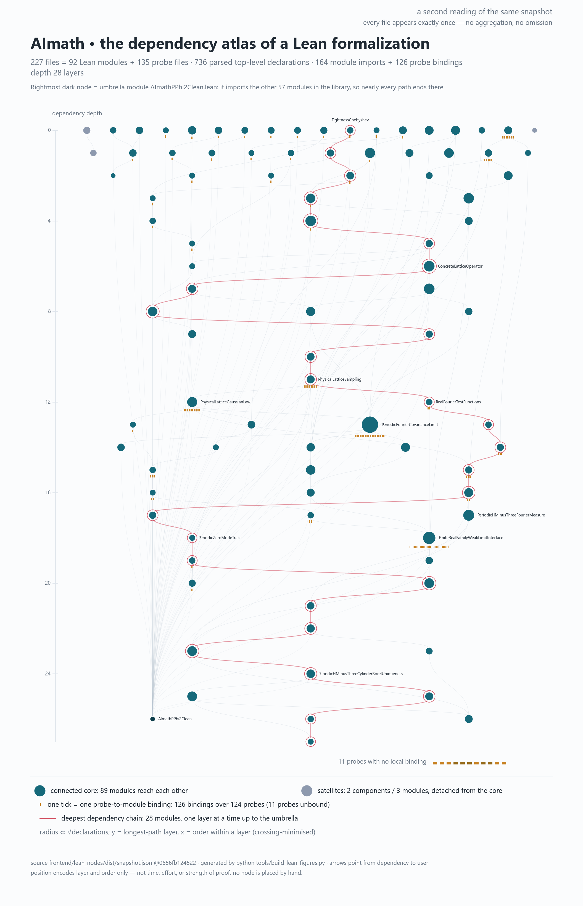

# pphi2-clean-finite-lattice



*The atlas depicts the wider AImath Lean development, not only the modules in this standalone repository.*

A self-contained Lean 4 development of the **finite periodic-lattice Gaussian
covariance** and a fixed-physical-volume weak-limit theorem for the periodic
free field, forming the base layer of constructive constructions of
$P(\varphi)_2$.  The covariance is not postulated from a spectral
representation: it is built from the concrete operator
$Q=-\Delta_a+m^2$ on $(\mathbb{Z}/N\mathbb{Z})^d$, whose self-adjointness,
negative semidefiniteness, positive definiteness, Hermitian matrix form and
positive eigenvalues are all proved, and whose eigenbasis then yields the
covariance $Q^{-1/2}$ with the Glimm--Jaffe normalization $a^{-d/2}$.

The development has **zero `sorry`**, **zero project axioms**, and a declared
footprint inside `{propext, Classical.choice, Quot.sound}` — the three standard
axioms of Lean and Mathlib — for every declaration the audit asks Lean about.
The audit that establishes this is in the repository, together with its logs
and a negative control showing that the firewall fires when an axiom is
injected.

## What is proved

| Layer | Result |
|---|---|
| Operator | $\Delta_a$ is self-adjoint; $\langle f,\Delta_a f\rangle=-a^{-2}\sum_i\sum_x(f(x+e_i)-f(x))^2\le0$; $Q=-\Delta_a+m^2$ is positive definite |
| Spectral data | the operator equals its matrix in the delta basis, so the finite-dimensional spectral theorem applies; orthonormal eigenbasis, real eigenvalues $>0$, Parseval, quadratic form $\langle f,Qf\rangle=\sum_k\lambda_k\langle e_k,f\rangle^2$ |
| Covariance | $Tf=\sum_k\lambda_k^{-1/2}\langle e_k,f\rangle e_k$ with $\langle Tf,Tg\rangle=\sum_k\lambda_k^{-1}\langle e_k,f\rangle\langle e_k,g\rangle$; the $a^{-d/2}$ normalization scales the bilinear form by $a^{-d}$ |
| Measure | the pushforward of finitely many independent standard Gaussians into the cylindrical weak dual; a probability measure; measurable; $L^2$; exact covariance $\int\omega(f)\omega(g)=\langle Tf,Tg\rangle$ |
| Exact moments | closed form in the mass eigenbasis, $a^{-d}\sum_k\lambda_k^{-1}\bigl(\sum_x e_k(x)f(x)\bigr)\bigl(\sum_x e_k(x)g(x)\bigr)$; and the same for the lifted configuration $\int(\eta_\omega(f))^2$ with **arbitrary** continuous linear evaluation functionals |
| Representation | an explicit coefficient embedding into $\ell^2(\mathbb{N})$ is an isometry, and under it the factor equals the upstream spectral coefficient formula |
| Interface | the lift to an arbitrary test space is continuous and measurable, equals evaluation on the induced test field, and transports $L^2$ bounds uniformly over a family |

Current source-derived totals (recomputed by `python verify.py --count`):
89 modules, 13505 lines and 800 declarations, of which 569 are
theorem-level -- the same numbers the companion manuscript quotes, because the
build recomputes them rather than typing them.  The axiom-report query count (64), per-module
interface certificates (27) and build-job count (8878) belong to the pinned
archive evidence and are not counts of this newer weak-limit extension.
`PROVENANCE.md` separates these layers.

## One step beyond the pinned archive

The repository also publishes a single step taken *after* the archive was
pinned: the **physical sampling convention** and the **UV-uniform second-moment
bound**.

| Post-pin result | Statement |
|---|---|
| Spectral floor | $m^2\le\lambda_k$ for every eigenvalue of the mass operator, with the *same* $m^2$ for every lattice spacing — constant functions attain it |
| Sampled covariance | $\langle T_{\mathrm{GJ}}\varphi_f,T_{\mathrm{GJ}}\varphi_f\rangle\le m^{-2}\lVert f\rVert_{a,N}^2$ for the Riemann sample $\varphi_f=a^d(f(ax))_{x\in\Lambda}$ |
| Spacing-uniform bound | at fixed physical volume $L=aN$, $\int(\omega f)^2\,\mathrm{d}\mu_{a,N}\le m^{-2}L^d\lVert f\rVert_\infty^2$ — the constant sees neither $a$ nor $N$ |

This bound alone is not a weak-limit theorem. The stronger result now published
here is the finite-source whole-sequence convergence theorem below; the earlier
sampling bound remains a distinct ingredient in the package.

## Fixed-volume weak limit

For a positive period $L$ and mass $m$, the package constructs finite periodic
lattice Gaussian laws $\mu_n$ with lattice size $N=n+1$ and spacing
$a=L/(n+1)$, and proves their weak convergence on a concrete weighted Fourier
$H^{-3}$ probability carrier. The theorem combines the uniform $H^{-2}$ energy
moment, compact sublevels in $H^{-3}$, tightness and Prokhorov extraction,
convergence of every finite Fourier cylinder to the periodic massive-resolvent
Gaussian marginal, Borel generation by cylinders, and measure uniqueness. The
identified limit is an actual Borel probability measure, denoted
$\mu_{\mathrm{free}}$ in the companion manuscript.

The public Lean entry point is `AImathPPhi2Clean.PeriodicHMinusThreeWeakLimitMarginal`;
build it with:

```bash
lake build AImathPPhi2Clean.PeriodicHMinusThreeWeakLimitMarginal
```

The main declaration is
`periodicHMinusThree_fixedVolume_weak_limit_exists_with_expected_cylinders`.
The formal source is in `AImathPPhi2Clean/PeriodicHMinusThreeWeakLimitMarginal.lean`
and its transitive project imports are included in this repository. The
The manuscript PDF, its modular LaTeX source, its build script and its
axiom transcript are in `paper/PPHI2_FIXED_VOLUME_COMPLETE/`.

This theorem concerns the constructed finite-source sequence.  Its
carrier-valued lift is the finite-source Fourier lift, whose total range
and Borel measurability the manuscript proves outright; what the
*development* carries as an input is a different, coordinatewise lift
together with its almost-everywhere agreement, and the manuscript's §13
says which of the two is which.  No interacting-field limit is asserted.

## The paper

`paper/PPHI2_FIXED_VOLUME_COMPLETE/` holds the current manuscript: 43 pages,
Part I mathematics and Part II the Lean development above.

```bash
cd paper/PPHI2_FIXED_VOLUME_COMPLETE
python build_all.py                 # numbers, ledger, transcript gate, PDF
python build_all.py --check-only    # the gates alone, no TeX
```

The build recomputes every structural number from these sources, renders
Appendices A and B from the recorded transcript and the registry, and then
fails on any overfull box or undefined reference — Tectonic exits 0 on both,
so a green exit is not enough.  It needs Python 3.10+ and Tectonic 0.17.0
(`$env:TECTONIC`, or on `PATH`); the first run fetches the TeX bundle unless
`$env:TECTONIC_CACHE_DIR` points at a seeded cache.

Expected: `4/4` paper checks, `13/13` negative controls, `overfull 0 /
undefined 0`, and a 43-page `main.pdf`.

Two independent audits of this manuscript are in `docs/`; the second was
written by referees who were not shown the first.

## What is *not* claimed

This remains a **free**, **fixed finite physical-volume** result. It is not an
infinite-volume limit, does not construct an interacting measure, and does not
prove Osterwalder--Schrader reconstruction. The theorem's source and scope are
explicit in the Lean declaration and companion manuscript. The gates below are
equally explicit about what a machine check cannot establish: it cannot tell you
that a formal statement is the intended one.

## Layout

```
AImathPPhi2Clean.lean                  root module (imports the library)
AImathPPhi2Clean/
  ConcreteLatticeOperator.lean         Δ_a, Q, matrix bridge, spectral data
  ConcreteLatticeCovariance.lean       Q^{-1/2}, Glimm–Jaffe normalization
  ConcreteGaussianMoment.lean          the measure, exact moments, the lift
  NumberedLatticeGaussianMoment.lean   the Fin n (numbered) interface
  LatticeCovarianceRepresentation.lean ℓ² coefficient embedding, isometry
  LatticeGaussianContinuumConsumer.lean consumer interface, L² transfer
  PhysicalLatticeGaussianBound.lean    post-pin: eigenvalue floor, sampled bound
  PhysicalLatticeSampling.lean         post-pin: the sampling convention
  ...                                  further clean interfaces (Wick,
                                       Nelson layer cake, tightness, positivity)
audit/                                 the gates and their logs (the evidence)
docs/                                  companion manuscript, archived README,
                                       the post-pin evidence transcript
verify.py                              portable verification entry point
PROVENANCE.md                          archive hash, delta policy, upstream pin
MANIFEST.sha256                        SHA-256 of every published file
```

Module-level documentation is in each file's header; the finite-lattice
migration begins at `ConcreteLatticeOperator.lean`.

## Build

Toolchain and dependency are pinned:

- Lean `leanprover/lean4:v4.34.0-rc2` (see `lean-toolchain`)
- Mathlib commit `85e3a25e006c35636f0e53b0e9296caca2685bc0`, which is the
  revision of the `v4.34.0-rc2` tag named in `lakefile.lean`

```bash
lake build AImathPPhi2Clean
lake build AImathPPhi2Clean.PeriodicHMinusThreeWeakLimitMarginal
```

Mathlib is a git dependency; `lake exe cache get` fetches the prebuilt
Mathlib for this exact revision, after which the build is local.  Building
Mathlib from source instead takes hours and is not required.  Nothing else
is needed — no other dependency, no generated code.  On Lean
`v4.34.0-rc2` with this Mathlib revision the library target elaborates all
89 modules with no error.

## Verify

```bash
python verify.py          # every published file against MANIFEST.sha256
python verify.py --ext    # the post-pin extension: hashes, coverage, axioms
python verify.py --count  # the numbers in this README, recomputed
python verify.py --lean   # additionally re-run the axiom gates (needs lake)
```

The full delivered gate, including the textual provenance check against the
upstream commit, is:

```bash
bash audit/run_finite_lattice_checks.sh /path/to/GaussianField
```

where the argument is a checkout of `mrdouglasny/GaussianField` at commit
`d63a28568a75d99f6cb27af1f888a49a69855a66`.  The scripts discover `lake` from
`$LAKE`, then `PATH`, then elan's default location, and the interpreter from
`$PYTHON` or `python3`; nothing is hard-coded to a particular machine.

What each gate establishes, and what it cannot, is documented in the companion
manuscript (in `docs/`), §9, and summarised in `PROVENANCE.md`.

## Provenance

The Lean sources here are **byte-identical** to a registered, audited archive
except for three audit scripts that carried machine-specific absolute paths and
were made portable, plus the library root, which gained two `import` lines for
the post-pin modules.  The exclusions (the upstream axiom-census tooling, which
depends on a private baseline checkout), the two post-pin modules and the full
delta are listed in `PROVENANCE.md`, and `verify.py` re-checks the manifest.
Definitions in `AImathPPhi2Clean/ConcreteLatticeOperator.lean` are adapted from
`mrdouglasny/GaussianField`; the correspondence is checked textually against
the pinned commit.  See `NOTICE`.

### The 2026-11-03 repair

An independent audit of the companion manuscript found that the tree this
repository published was not elaborable: one module had lost the header of
a declaration, and the lakefile required Mathlib with no revision while the
manifest pinned a different commit.  The header is restored, the dependency
is pinned, and ten modules were migrated to the APIs of the pinned Mathlib
revision; eight modules of the weak-limit extension are new here.  The
interface certificates and the build log under `audit/` are the **previous**
snapshot's records and are kept as such; the current evidence for the
repaired tree is the transcript in `paper/PPHI2_FIXED_VOLUME_COMPLETE/ext/`,
which records the toolchain, the Mathlib commit, the `#print axioms` output
for the ten chain theorems, and the digest of every module that declares
one of them.

## License

Apache-2.0 (`LICENSE`).  Attribution for the adapted definitions: `NOTICE`.
